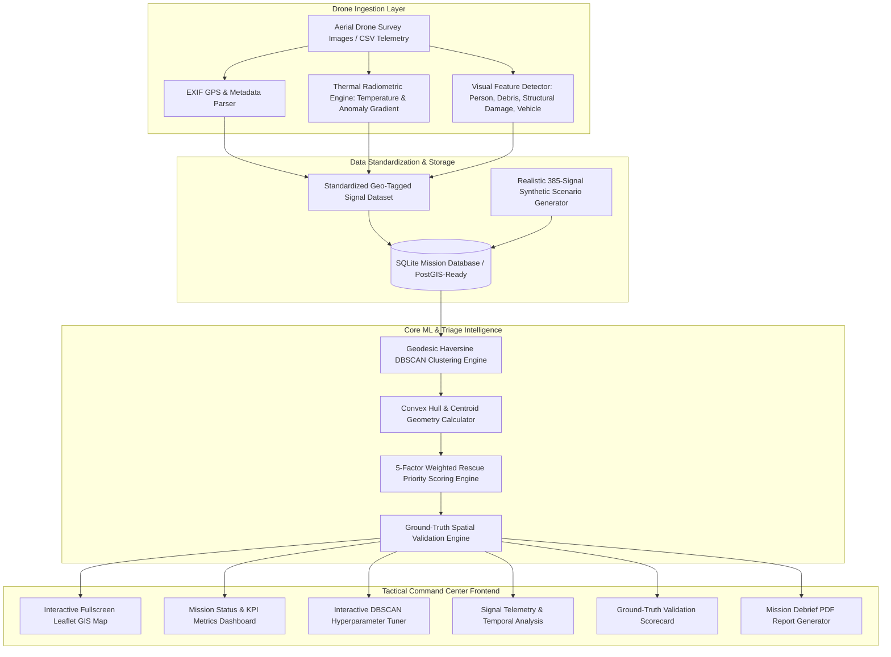

# DBSCAN-Based Hotspot Clustering of Drone-Survey Thermal and Visual Signals for Disaster Response Prioritization

**Mapping ID:** `SIH26030`  
**Domain:** Disaster Management / Computer Vision / Unsupervised Geospatial Intelligence  
**Decision-Support Classification:** Tactical Search & Rescue Prioritization Engine  

[](https://python.org)
[](https://fastapi.tiangolo.com)
[](https://scikit-learn.org)
[](https://reactjs.org)
[](https://tailwindcss.com)
[](https://leafletjs.com)

---

## 🛰️ 1. Project Overview & Objectives

In major natural or anthropogenic catastrophes (earthquakes, structural collapses, floods, and industrial hazards), aerial drone surveys produce gigabytes of sensor imagery. First responders and Urban Search and Rescue (USAR) teams cannot manually inspect thousands of image frames in real time during the critical 72-hour golden survival window.

This project delivers an end-to-end tactical disaster-response intelligence platform that ingests aerial drone imagery and telemetry, extracts calibrated thermal anomalies and multi-class visual probabilities, applies **geodesic Haversine DBSCAN spatial clustering**, and evaluates clusters through a transparent **5-factor rescue priority scoring engine**.

### 🎯 Primary Objectives:
1. **Extract Geo-tagged Thermal & Visual Signal Features** from drone aerial survey imagery (EXIF GPS parsing, thermal gradient anomalies, person/debris/damage/vehicle probabilities).
2. **Apply Haversine DBSCAN Spatial Clustering** ($R = 6,371\text{ km}$) to identify dense, arbitrarily shaped survivor pockets and structural collapse sectors without planar Euclidean distortion.
3. **Validate Clustered Hotspots Against Ground-Truth Rescue Zones** calculating Precision, Recall, F1 Score, Coverage %, and spatial distance error.

> [!IMPORTANT]
> **Operational Safety & Disclaimer Protocol**:
> All demo and simulated data is clearly labeled as `SIMULATED DATA`. Thermal anomalies are strictly categorized as *"Potential Human Signals"* and *"Potential Rescue Hotspots"*. DBSCAN identifies spatial point densities; it does not independently verify living survivors. The platform functions as an operational decision-support tool.

---

## 🏗️ 2. System Architecture



---

## 🔬 3. Core Algorithms & Mathematical Foundations

### A. Geodesic Haversine DBSCAN Clustering
Latitude and longitude represent spherical coordinates on the Earth ($R = 6,371,000\text{ m}$). Applying naive Euclidean distances on raw degrees produces severe longitudinal distortions. 

Our engine transforms coordinates into radians and executes Scikit-Learn DBSCAN with the `haversine` metric:

$$\mathbf{X}_{\text{rad}} = \left[\text{radians}(\text{lat}), \text{radians}(\text{lon})\right]$$

$$\epsilon_{\text{rad}} = \frac{\text{EPS}_{\text{meters}}}{6,371,000\text{ m}}$$

$$\text{labels} = \text{DBSCAN}\left(\epsilon = \epsilon_{\text{rad}}, \text{min\_samples} = k, \text{metric} = \text{'haversine'}\right).\text{fit\_predict}(\mathbf{X}_{\text{rad}})$$

- Points belonging to high-density neighborhoods are assigned cluster labels $k \ge 0$.
- Isolated outlier points are classified as **spatial noise** ($\text{cluster\_id} = -1$).
- Convex hulls are generated via `scipy.spatial.ConvexHull` and exported as GeoJSON polygons.

### B. 5-Factor Rescue Priority Scoring Model
Each detected cluster is evaluated through a weighted multi-sensor triage function:

$$\text{Priority Score} = \Big( 0.35 \cdot \bar{S}_{\text{thermal}} + 0.30 \cdot \bar{P}_{\text{human}} + 0.15 \cdot \bar{P}_{\text{debris}} + 0.10 \cdot \bar{P}_{\text{damage}} + 0.10 \cdot D_{\text{norm}} \Big) \times 100$$

Where $D_{\text{norm}} = \min\left(1.0, \frac{\text{Density}}{250\text{ pts/km}^2}\right)$ represents normalized spatial cluster density.

#### Triage Classification Tiers:
| Tier | Score Range | Recommended Field Action |
|---|---|---|
| **CRITICAL** | $90 - 100$ | **IMMEDIATE SEARCH & EXTRACTION**: Deploy heavy USAR teams and canine units. |
| **HIGH** | $75 - 89$ | **RAPID RECONNAISSANCE & ASSESS**: Dispatch aerial tactical team for structural entry. |
| **MEDIUM** | $50 - 74$ | **STRUCTURAL MONITORING**: Conduct secondary acoustic listening sweep. |
| **LOW** | $0 - 49$ | **ROUTINE PATROL & LOGISTICS**: Monitor perimeter and clear logistics routes. |

### C. Ground-Truth Validation Methodology
Cluster centroids $\mathbf{C}_i$ are matched to simulated ground truth sectors $\mathbf{G}_j$ via greedy minimum Haversine distance pairing within threshold radius $r_{\text{match}} = 140\text{ m}$:

$$\text{Precision} = \frac{TP}{TP + FP} \times 100\% \quad\quad \text{Recall} = \frac{TP}{TP + FN} \times 100\%$$

$$\text{F1 Score} = 2 \cdot \frac{\text{Precision} \cdot \text{Recall}}{\text{Precision} + \text{Recall}} \quad\quad \text{Spatial Error} = \frac{1}{|TP|}\sum d(\mathbf{C}_i, \mathbf{G}_j)$$

---

## 💻 4. Technology Stack

- **Frontend**: React 19, Vite, Tailwind CSS v4, React Router v7, Leaflet & React-Leaflet, Recharts, Framer Motion, Lucide React.
- **Backend**: Python 3.11+, FastAPI, Uvicorn, Pydantic v2, SQLAlchemy, Scikit-Learn, NumPy, Pandas, SciPy, OpenCV, Pillow, Piexif.
- **Database**: SQLite (architected with clean SQLAlchemy models for seamless migration to PostgreSQL/PostGIS).
- **Mapping**: Leaflet with CartoDB Dark Matter & OpenStreetMap basemaps (Zero paid API dependencies).

---

## 🚀 5. Installation & Setup

### Prerequisites
- **Python 3.11+** installed
- **Node.js 18+** & **npm** installed

### A. Backend Setup
```bash
# Navigate to backend
cd backend

# Create and activate virtual environment (or use uv)
uv venv
# On Windows:
.venv\Scripts\activate
# On Linux/macOS:
source .venv/bin/activate

# Install dependencies
pip install -r requirements.txt
# (or: uv add fastapi uvicorn scikit-learn numpy pandas scipy opencv-python-headless pillow piexif sqlalchemy python-multipart pytest httpx)
```

### B. Frontend Setup
```bash
# Navigate to frontend
cd frontend

# Install npm dependencies
npm install
```

---

## ⚡ 6. Running the Application

### 1. Start the Backend Server (Port 8000)
```bash
# In the backend directory (with virtualenv activated):
python run.py
# or: uvicorn backend.app.main:app --host 0.0.0.0 --port 8000 --reload
```
*Backend Swagger Docs will be available at:* `http://localhost:8000/docs`

### 2. Start the Frontend Development Server (Port 5173)
```bash
# In the frontend directory:
npm run dev
```
*Open your browser at:* `http://localhost:5173`

---

## 🗺️ 7. The 9 Application Pages

1. **Landing Page (`/`)**: Strategic overview, interactive 5-stage pipeline diagram, problem statement, technical summary, and launch CTA.
2. **Mission Dashboard (`/dashboard`)**: Central command map, top 6 KPI telemetry stats, mission status bar, live cluster ranking, and cluster inspector drawer.
3. **Drone Data & Ingest (`/data`)**: File dropzone for JPEG/PNG/TIFF/CSV, real EXIF GPS parser, manual GPS entry modal, and processing trigger.
4. **Signal Analysis (`/signals`)**: Deep signal telemetry view with thermal anomaly histograms, visual confidence scatter plots, signal table with multi-column filtering and CSV export.
5. **Tactical Hotspot Map (`/map`)**: Fullscreen GIS interface with layer controls (Thermal, Visual, Clusters, Noise, Flight Path, Ground Truth), Time Slider (08:00 to 18:00), and animated Drone Flight replay ("Play Mission").
6. **DBSCAN Clustering (`/clustering`)**: Interactive parameter controller (`EPS` slider, `Min Samples` slider), [Run DBSCAN] live recalculation, noise point analysis, and cluster density breakdown.
7. **Cluster Analytics (`/analytics`)**: Sortable master cluster table and multi-metric visual dashboard (Priority Distribution, Cluster Size Bar Chart, Feature Radar, Noise vs Clustered Donut).
8. **Ground-Truth Validation (`/validation`)**: Benchmark scorecard (Precision, Recall, F1, Coverage, Spatial Error in meters), predicted vs ground-truth map overlay, and pairwise evaluation table.
9. **System Technical Docs (`/system-info`)**: In-depth theory documentation covering DBSCAN math, Haversine formula, 5-factor scoring, and operational limitations.

---

## 🧪 8. Automated Test Suite

Run the full backend test suite covering clustering, scoring, validation, demo generator, and API endpoints:
```bash
# In workspace root:
backend\.venv\Scripts\python.exe -m pytest backend/tests -v
```

Test coverage includes:
- `test_clustering.py`: Verifies Haversine DBSCAN correctly groups dense signals and isolates noise points.
- `test_scoring.py`: Validates 5-factor score weighting, bounds [0, 100], and classification labels.
- `test_validation.py`: Verifies Haversine geodesic distance accuracy, precision, recall, and distance error metrics.
- `test_demo_generator.py`: Ensures 350+ realistic signals across irregular sectors with ~15% noise.
- `test_api.py`: End-to-end REST API integration tests.

---

## 📡 9. REST API Endpoints Reference

| Method | Endpoint | Description |
|---|---|---|
| `POST` | `/api/missions/demo` | Seeds or resets the 385-signal realistic disaster scenario. |
| `GET` | `/api/missions/current` | Returns the active mission and summary KPI statistics. |
| `GET` | `/api/missions/statistics` | Returns overall mission dashboard metrics. |
| `POST` | `/api/data/upload` | Ingests image files (JPEG/PNG/TIFF) and CSV signal datasets. |
| `POST` | `/api/data/process-images` | Converts pending images into standardized signal records. |
| `POST` | `/api/data/manual-gps` | Manually updates GPS coordinates for images lacking EXIF metadata. |
| `GET` | `/api/data/images` | Lists uploaded drone images with EXIF status. |
| `POST` | `/api/clustering/run` | Executes Scikit-Learn Haversine DBSCAN with custom `eps_meters` and `min_samples`. |
| `GET` | `/api/clustering/clusters` | Returns detected clusters with GeoJSON convex hull polygons and priority scores. |
| `GET` | `/api/clustering/clusters/{id}` | Returns cluster details with member signal list. |
| `GET` | `/api/clustering/signals` | Returns filterable signal points. |
| `POST` | `/api/validation/evaluate` | Evaluates predicted clusters against ground-truth disaster sectors. |
| `GET` | `/api/validation/results` | Returns latest Precision, Recall, F1, and distance error metrics. |
| `GET` | `/api/validation/ground-truth` | Returns simulated ground-truth rescue zones. |
| `GET` | `/api/report/summary` | Aggregates the full mission debrief report payload. |
| `GET` | `/api/report/flight-path` | Returns drone flight survey trajectory waypoints. |

---

## 🐳 10. Docker Deployment

Deploy the full stack using Docker Compose:
```bash
docker-compose up --build
```
- Frontend will be live at: `http://localhost:5173`
- Backend API will be live at: `http://localhost:8000`

---

## ⚠️ 11. Known Limitations & Operational Considerations

1. **Decision-Support Classification**: The platform identifies spatial concentrations of sensor signals. It does not replace field human triage or physical acoustic/canine verification.
2. **Thermal False Positives**: Heat anomalies can be generated by solar-heated metal roofing, vehicle cooling systems, smoldering biomass, or industrial transformers.
3. **GPS Accuracy**: Handheld or consumer drone GPS accuracy typically ranges between $\pm 3\text{ m}$ to $\pm 10\text{ m}$. In dense urban canyons, multi-path signal reflections may slightly offset detections.

---

## 🔮 12. Future Enhancements

- Integration of Real-time RTK-GPS drone telemetry feeds via WebSocket.
- PostGIS database migration for multi-mission regional spatial indexing.
- Deep-learning thermal super-resolution and YOLO-v8 USAR person detector sidecars.
- Offline Edge-deployment optimization for field ruggedized tablets in disconnected disaster zones.
